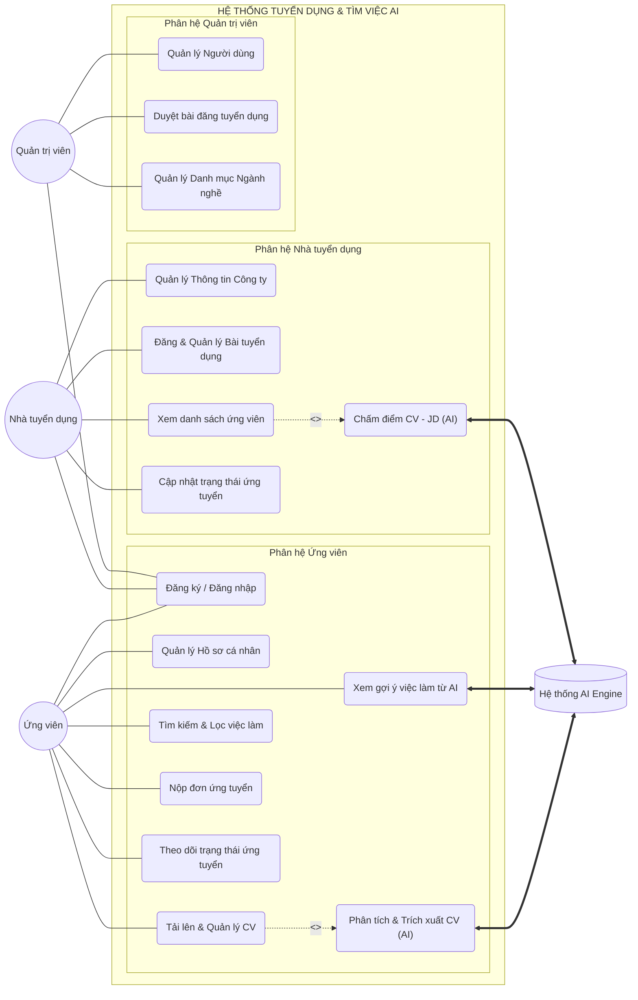
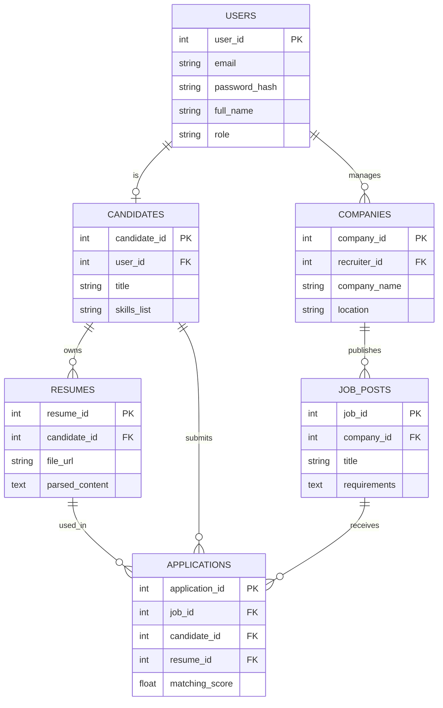
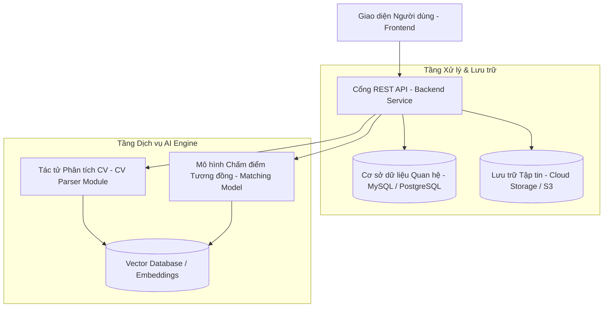
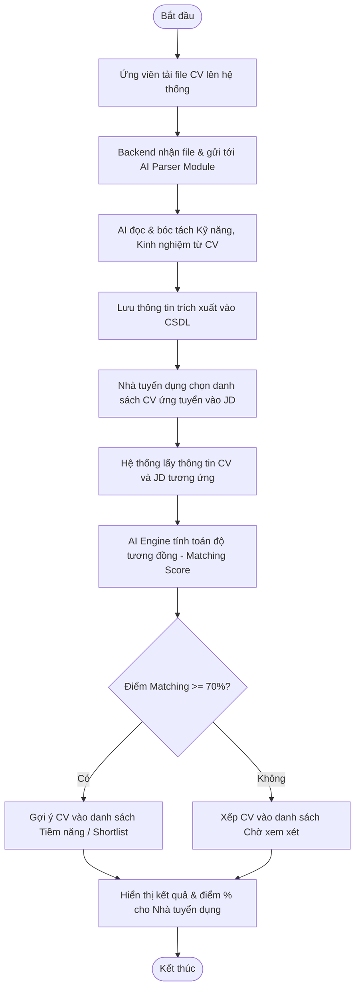
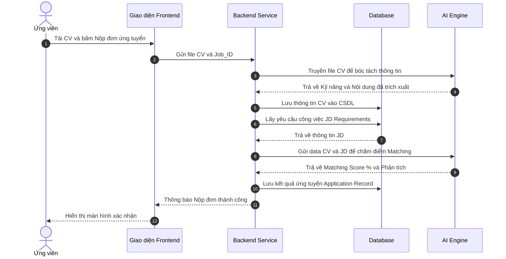

# ĐỒ ÁN: HỆ THỐNG TUYỂN DỤNG VÀ TÌM KIẾM VIỆC LÀM AI

## I. NHÓM 1: SƠ ĐỒ PHÂN TÍCH YÊU CẦU

### 1. Sơ đồ Use Case


---

## II. NHÓM 2: THIẾT KẾ CSDL VÀ KIẾN TRÚC

### 1. Sơ đồ ERD (Entity-Relationship Diagram)


### 2. Sơ đồ Kiến trúc Hệ thống


---

## III. NHÓM 3: SƠ ĐỒ LUỒNG VÀ ĐỘNG LỰC

### 1. Sơ đồ Luồng (Activity Diagram)


### 2. Sơ đồ Tuần tự (Sequence Diagram)

## IV. THIẾT KẾ CỔNG KẾT NỐI API (RESTFUL API SPECS)

### 1. Luồng Upload & Parse CV bằng AI
* **Endpoint:** `POST /api/v1/resumes/upload`
* **Request:** `FormData` chứa file CV
* **Response:**
```json
{
  "status": "success",
  "data": {
    "resume_id": 12,
    "parsed_skills": ["Python", "FastAPI", "PyTorch", "SQL"],
    "experience_years": 2,
    "file_url": "[https://storage.example.com/cvs/candidate_12.pdf](https://storage.example.com/cvs/candidate_12.pdf)"
  }
}
```

### 2. Luồng Chấm điểm CV & JD Matching
* **Endpoint:** `GET /api/v1/jobs/{job_id}/applications`
* **Response:**
```json
{
  "job_id": 101,
  "candidates": [
    {
      "candidate_id": 5,
      "full_name": "Nguyen Van A",
      "matching_score": 85.5,
      "ai_analysis": "Ứng viên đáp ứng tốt yêu cầu Python và AI framework, thiếu 1 năm kinh nghiệm so với YC."
    }
  ]
}
```
